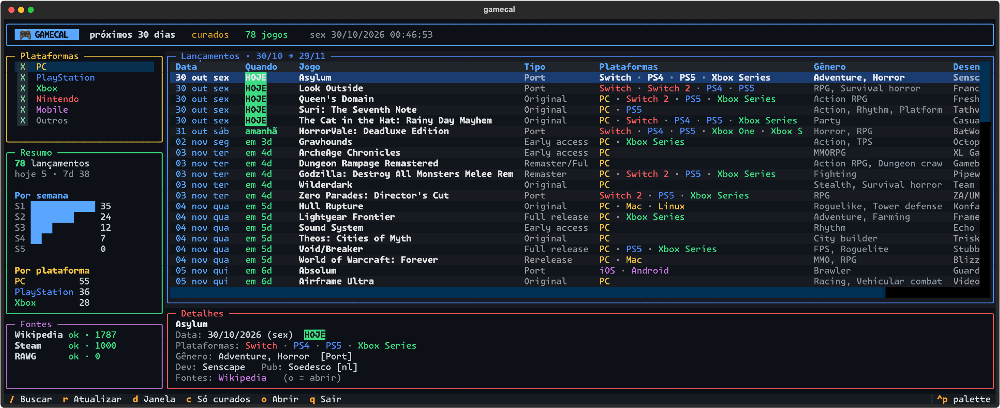
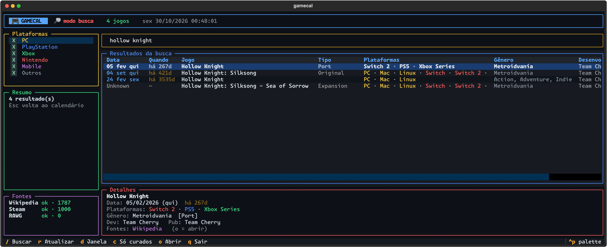

<h1 align="center">🎮 gamecal</h1>

<p align="center">
  <b>Calendário de lançamentos de games direto no terminal</b><br>
  Visual estilo <i>btop</i> · PC, PlayStation, Xbox, Nintendo e mobile · busca de jogos lançados ou não
</p>

<p align="center">
  
</p>

## ✨ O que faz

- **Próximos lançamentos** (7, 15, 30, 60 ou 90 dias) com nome, data, contagem regressiva, plataformas, gênero, desenvolvedora e tipo (original, port, remaster, early access…).
- **Filtro por plataforma:** PC, PlayStation, Xbox, Nintendo, Mobile.
- **Painel de resumo:** lançamentos por semana e por plataforma, em barras.
- **Busca de jogos** (`/`), lançados ou ainda por lançar.
- **Várias fontes** unidas sem duplicar o mesmo jogo.
- **Cache local**, então abre rápido e funciona bem em reaberturas.
- Abre a página do jogo no navegador (`o`).

<p align="center">
  
</p>

## 📦 Instalação

Requisitos: **Python 3.10+**, internet e um terminal com cores e Unicode (macOS, Linux, Windows Terminal).

```bash
# recomendado: isola as dependências
pipx install git+https://github.com/engjoaofaro/gamecal

# ou com pip
pip install git+https://github.com/engjoaofaro/gamecal
```

Depois, em qualquer pasta:

```bash
gamecal
```

Atualizar: `pipx upgrade gamecal` · Remover: `pipx uninstall gamecal`.

<details>
<summary>Rodar a partir do código-fonte</summary>

```bash
git clone https://github.com/engjoaofaro/gamecal && cd gamecal
python3 -m venv .venv && .venv/bin/pip install -e .
.venv/bin/gamecal
```
</details>

## ⌨️ Atalhos

| Tecla | Ação |
|---|---|
| `/` | Buscar jogo (Enter confirma, `Esc` volta ao calendário) |
| `r` | Atualizar, ignorando o cache |
| `d` | Alternar a janela: 7 → 15 → 30 → 60 → 90 dias |
| `c` | Alternar entre só **curados** e **todos** (inclui jogos que só a Steam lista) |
| `o` | Abrir a página do jogo selecionado |
| `↑` `↓` | Navegar na lista |
| `Tab` + `Espaço` | Marcar/desmarcar plataformas no filtro |
| `q` | Sair |

## 🔤 Fonte recomendada

O app roda no seu terminal, então a fonte é a do seu terminal. O visual dos screenshots usa a
**[Monaspace Krypton](https://monaspace.githubnext.com/)** (GitHub, licença OFL), que combina bem com o clima "game":

```bash
brew install --cask font-monaspace        # macOS
```

Depois, escolha `Monaspace Krypton` nas configurações de fonte do seu terminal (Ghostty, iTerm2, WezTerm, Kitty, Windows Terminal…).
Uma fonte monoespaçada com emojis e ícones funciona bem também; sem a Krypton, tudo continua utilizável.

## 🌐 Fontes de dados

| Fonte | Chave | Cobre |
|---|---|---|
| **Wikipedia** (listas de jogos lançados por ano) | não precisa | Multiplataforma, com gênero, dev e publisher |
| **Steam** (loja) | não precisa | PC, com datas exatas de "em breve" e busca com detalhes |
| **RAWG** | opcional | Catálogo grande, melhora muito a busca de jogos antigos |

Para ativar a RAWG, crie uma chave grátis em <https://rawg.io/apidocs> e exporte:

```bash
export RAWG_API_KEY="sua-chave"
```

O painel **Fontes** mostra o estado de cada uma (`ok · quantidade` ou `erro`).
O cache fica em `~/.cache/gamecal` (Wikipedia: 6h, Steam: 1h, RAWG: 3h).

### "Curados" vs "todos"

A Steam lista centenas de jogos pequenos por semana. Por padrão o calendário mostra só os "curados", ou seja, os que aparecem
na Wikipedia ou na RAWG. Os demais ficam ocultos e o painel avisa quantos são (`+601 só-Steam ocultos`). Aperte `c` para ver tudo.

## ⚠️ Limitações

- Os dados da Wikipedia e da Steam são lidos do HTML/APIs públicas. Se o formato mudar, uma fonte pode falhar e o painel **Fontes** vai mostrar `erro`.
- Jogos da Wikipedia sem dia exato (só "Q4", "December" ou "TBA") não entram no calendário, mas aparecem na busca.
- Sem chave RAWG, a busca de jogos antigos cobre só a Steam e as listas da Wikipedia (ano anterior, atual e próximo).
- As datas podem variar por região e mudar com adiamentos. Confira na página oficial antes de reservar.
- Testado em macOS. Linux e Windows devem funcionar, mas não foram verificados.

## 🛠️ Desenvolvimento

O app inteiro está em um único arquivo, [`gamecal.py`](gamecal.py): parsers das fontes, mesclagem e a interface em [Textual](https://textual.textualize.io).
Dependências: `textual` e `httpx`.

Ideias para o futuro: lembretes de lançamento, exportar para calendário (`.ics`), mais fontes (IGDB, Nintendo, PlayStation Store), temas.
Pull requests são bem-vindos.

## 📄 Licença

[MIT](LICENSE)
